<picture> <source media="(prefers-color-scheme: dark)" srcset="./assets/header-dark.svg">  </picture>

**Desenvolvedor Full Stack** com atuação em aplicações web, mobile, back-end, bancos de dados e infraestrutura, trabalhando do desenvolvimento à implantação de soluções em produção.

No **CESAM – Centro de Estudos em Saneamento Ambiental**, Desenvolvo plataformas públicas voltadas a dados de saneamento e resíduos sólidos de Mato Grosso do Sul.

Também desenvolvo projetos envolvendo **inteligência artificial, geotecnologias, otimização e automação**.

**Aberto a oportunidades Full Stack, projetos freelance e colaborações em tecnologia.**

[LinkedIn](https://www.linkedin.com/in/lucas-beraldi-b632a614b/) · [CESAM no GitHub](https://github.com/CESAM-LASANGE) · [CESAM no GitHub](https://github.com/FlightWatchApp/FlightWatch)

  <a href="https://observatorio-saneamento-ms.vercel.app"><picture><source media="(prefers-color-scheme: dark)" srcset="./assets/observatorio-dark.svg"></picture></a>
  <a href="https://portal-de-residuos.vercel.app"><picture><source media="(prefers-color-scheme: dark)" srcset="./assets/residuos-dark.svg"></picture></a>
  <a href="https://github.com/FlightWatchApp/FlightWatch"><picture><source media="(prefers-color-scheme: dark)" srcset="./assets/flightwatch-dark.svg"></picture></a>

## Projetos pessoais

- **[AvaliacaoLLM](https://github.com/LBeraldi/AvaliacaoLLm)** — avaliação reproduzível de respostas de LLMs de vários provedores, com A/B cego e juiz LLM. Publicado com [DOI no Zenodo](https://doi.org/10.5281/zenodo.21980030).
  `Python` `Inspect AI` `pytest` `CI`
- **[GeoFito](https://github.com/LBeraldi/FitoGeo)** — app de campo que identifica plantas por foto e mostra bioma, município e legislação ambiental.
  `React Native` `Expo` `Node.js` `TypeScript` `PostGIS`
- **[SwOPy](https://github.com/LBeraldi/Otimizacao-Gamero)** — otimização de redes coletoras de esgoto por algoritmo genético, reproduzindo uma dissertação da UFMS.
  `Python` `NumPy` `pandas` `Optuna`
