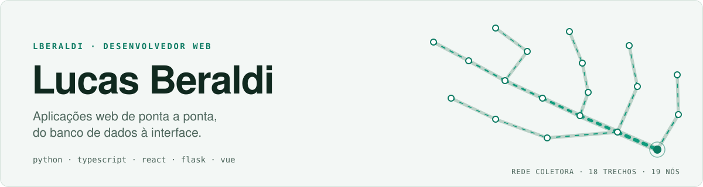
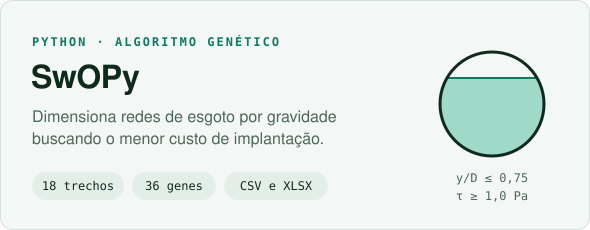
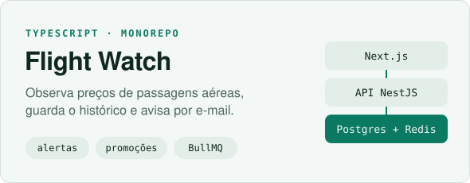
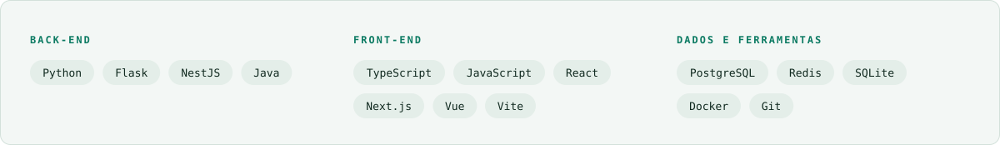

<picture>
  <source media="(prefers-color-scheme: dark)" srcset="assets/header-escuro.svg">
  
</picture>

Sou desenvolvedor web e gosto de levar uma ideia do banco de dados até a interface. Trabalho com **Python** e **TypeScript**, usando **React**, **Next.js** ou **Vue** no front-end. Meus destaques hoje são o **Flight Watch**, que acompanha preços de passagens aéreas, e o **SwOPy**, que usa um algoritmo genético para dimensionar redes de esgoto pelo menor custo.

## Contribuições

<picture>
  <source media="(prefers-color-scheme: dark)" srcset="https://raw.githubusercontent.com/LBeraldi/LBeraldi/output/contribuicoes-escuro.svg">
  
</picture>

## Projetos

<a href="https://github.com/LBeraldi/Otimizacao-Gamero">
  <picture>
    <source media="(prefers-color-scheme: dark)" srcset="assets/projeto-swopy-escuro.svg">
    
  </picture>
</a>
<a href="https://github.com/FlightWatchApp/FlightWatch">
  <picture>
    <source media="(prefers-color-scheme: dark)" srcset="assets/projeto-flight-watch-escuro.svg">
    
  </picture>
</a>

## Stack

<picture>
  <source media="(prefers-color-scheme: dark)" srcset="assets/stack-escuro.svg">
  
</picture>

## Contato

[LinkedIn](https://www.linkedin.com/in/lucas-beraldi-b632a614b) · [Instagram](https://www.instagram.com/lucas.beraldii)
